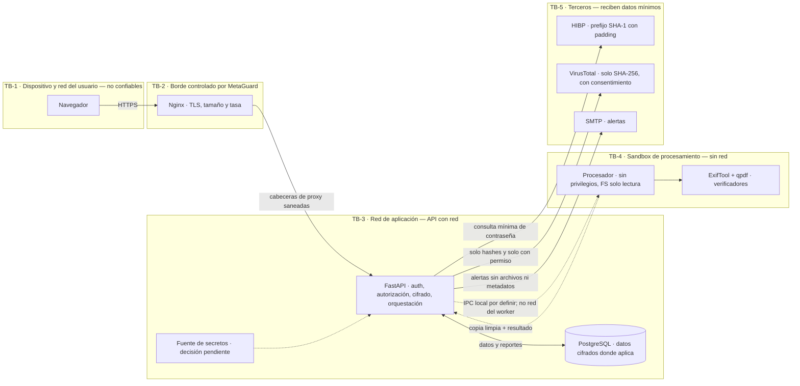

# Arquitectura propuesta de MetaGuard

**Propósito:** fijar los componentes y límites de confianza que debe demostrar OBJ-01. **Estado:** diseño propuesto; no implementado.

## Contenido

## Decisiones y límites

| Componente | Responsabilidad / límite |
|---|---|
| Navegador | Interfaz y carga. Archivo, URL, nombre y cabeceras del cliente son datos no confiables. |
| Nginx | TLS, límite de cuerpo y tasa. Descarta cabeceras IP aportadas por el cliente y establece una IP de origen confiable según la topología desplegada. |
| API | Autenticación, CSRF, autorización por objeto, validación de solicitud, SHA-256 sin interpretar el archivo, persistencia cifrada y coordinación. No parsea el formato. |
| Procesador | `ProcessingSupervisor` fija imagen, comando y opciones Docker; entrega solo bytes y MIME mediante stdin al worker privado. El worker reutiliza `process_file`; el contenedor corre sin red ni privilegios, con raíz de solo lectura y límites de recursos. Ve el archivo en claro mientras lo procesa. |
| PostgreSQL | Usuarios, reportes, eventos y caché con sus retenciones. No debe recibir archivos binarios ni valores sensibles en claro cuando la propuesta exige cifrado por campo. |
| Servicios externos | HIBP recibe solo prefijo SHA-1 y padding; VirusTotal recibe hashes SHA-256 únicamente con consentimiento por archivo; SMTP no recibe archivos. |

La propuesta define al operador como confiable, pero no como incapaz de ver el archivo: el servidor lo procesa en claro durante unos segundos. El contrato privado supervisor–worker ya limita el mensaje a bytes y MIME, pero su cableado con API, el transporte API–procesador y la fuente de llaves siguen **PENDIENTES**. El procesador no debe tener ruta de red hacia la API ni Internet; el IPC local debe respetar esa propiedad.

## Qué pasa si falta

Sin límites de confianza y separación comprobable, un archivo hostil podría alcanzar componentes con red o datos persistentes y la promesa de aislamiento no se podría evaluar. La figura no prueba que el despliegue real respete los límites.

## Verificación planificada

El código configura `--network=none`, `--read-only`, usuario no-root, capacidades vacías, `no-new-privileges`, 1 GiB/1 vCPU, 60 s, 64 MiB de `/tmp` y limpieza por nombre de contenedor. La ejecución de Docker, el comportamiento de la imagen construida y la verificación efectiva del aislamiento siguen **PENDIENTES**; esta unidad no conecta la API ni demuestra el despliegue.

## Candidato para conectar API y procesador

**Estado: diseño propuesto para una demo Linux; no está implementado ni verificado.** El objetivo es permitir el procesamiento real sin entregar control de Docker a la API ni llaves de cifrado al procesador. Una revisión de seguridad independiente señaló las condiciones y riesgos descritos aquí. No habilitar cargas reales hasta implementarlos y comprobarlos.

### Flujo y autoridad

1. La API comprueba autenticación, origen/CSRF, titularidad y consentimiento antes de admitir la carga. Aplica los límites aprobados para demo y cifra cualquier archivo que deba persistir; la política de llaves de producción sigue pendiente.
2. Un servicio supervisor confiable en el host recibe de la API **solo bytes y tipo de medio permitido** por un socket Unix de flujo dedicado. Lanza el procesador existente con imagen y argumentos fijados; responde con el resultado acotado. El contenedor aislado no recibe el socket de la API, el socket Docker, llaves ni acceso de red.
3. La API verifica el resultado del protocolo y lo entrega como descarga segura. El archivo procesado sigue siendo contenido no confiable; la marca interna de verificación no prueba seguridad frente a una ejecución de código dentro del procesador.

El supervisor tiene autoridad sobre Docker y debe tratarse como **componente privilegiado del host**, no como una extensión inocua de la API. Requiere una configuración confiable y explícita de ejecutable absoluto, socket Unix local, directorio de configuración e imagen por digest; sus procesos reciben únicamente `DOCKER_HOST` y `DOCKER_CONFIG`, sin heredar el entorno. La validación sintáctica no demuestra propiedad o permisos de esas rutas ni procedencia de la imagen. El despliegue debe verificarlos. No debe aceptar del cliente rutas, nombres de contenedor, imágenes, comandos, opciones, montajes ni variables de entorno. La compatibilidad de esta configuración con Docker real aún no se ha probado.

### Requisitos previos de implementación

- El directorio padre y el socket son propiedad del supervisor y no son modificables por la API; permisos restrictivos y credenciales de pares Linux autentican **ambos extremos antes de transferir datos**. Deben comprobarse los UID reales y su correspondencia entre espacios de nombres. La identidad del proceso no sustituye autorización del usuario ni titularidad del archivo.
- El protocolo debe ser versionado y con longitudes explícitas, una tarea por conexión, esquemas cerrados, tipos permitidos y límites comprobados antes de reservar memoria. Rechazar mensajes truncados, campos repetidos, tramas adicionales y datos auxiliares no admitidos. No usar pickle ni rutas aportadas por el cliente.
- Limitar globalmente tareas activas, cola y bytes acumulados, además de tiempo de lectura, escritura, ejecución y limpieza. La desconexión no debe dejar trabajos sin seguimiento. Mantener el cupo retenido hasta confirmar limpieza.
- Ante limpieza no verificable, el servicio debe rechazar nuevas tareas hasta reconciliarse. Tras reinicio o caída del daemon, inventariar tareas propias mediante identificadores y etiquetas controlados; nunca borrar contenedores por coincidencia amplia de nombre.
- Evitar registrar contenido, nombres sensibles o resultados crudos. La memoria temporal no garantiza ausencia de persistencia: deben evaluarse buffering multipart y del proxy, archivos temporales, swap, hibernación y volcados. No prometer borrado criptográfico ni eliminación segura de objetos inmutables de Python.

### Evidencia necesaria antes de usarlo

Las pruebas deberán cubrir pares no autorizados, socket falsificado y mapeo de UID; tramas fragmentadas o excesivas, clientes lentos y desconexiones; cuotas concurrentes y saturación; aislamiento real de red, montajes y recursos; caída del supervisor o daemon y recuperación de huérfanos; y ausencia de datos señuelo en logs y almacenamiento temporal. También deberán comprobar autorización entre usuarios, consentimiento, cifrado, descarga y vencimiento. Las pruebas simuladas no sustituyen la inspección del aislamiento real.

Referencias: [seguridad del daemon Docker](https://docs.docker.com/engine/security/), [sockets Unix y credenciales de pares en Linux](https://man7.org/linux/man-pages/man7/unix.7.html) y [consideraciones de tmpfs y swap](https://docs.docker.com/engine/storage/tmpfs/).
