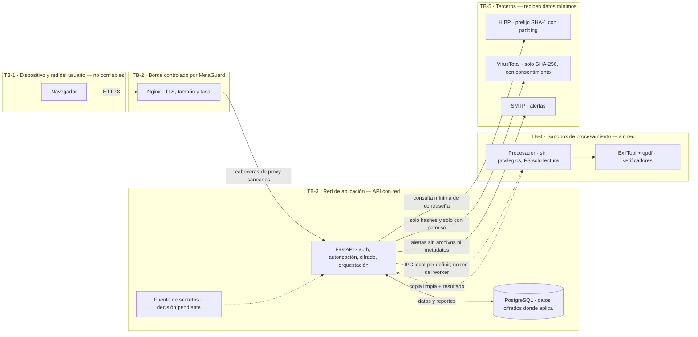

# Arquitectura propuesta de MetaGuard

**Propósito:** fijar los componentes y límites de confianza que debe demostrar OBJ-01. **Estado:** diseño propuesto; no implementado.

## Contenido

## Decisiones y límites

| Componente | Responsabilidad / límite |
|---|---|
| Navegador | Interfaz y carga. Archivo, URL, nombre y cabeceras del cliente son datos no confiables. |
| Nginx | TLS, límite de cuerpo y tasa. Descarta cabeceras IP aportadas por el cliente y establece una IP de origen confiable según la topología desplegada. |
| API | Autenticación, CSRF, autorización por objeto, validación de solicitud, SHA-256 sin interpretar el archivo, persistencia cifrada y coordinación. No parsea el formato. |
| Procesador | Valida tipo real y dimensiones; limpia/verifica en sandbox sin red, sin privilegios y con FS de solo lectura. Ve el archivo en claro mientras lo procesa. |
| PostgreSQL | Usuarios, reportes, eventos y caché con sus retenciones. No debe recibir archivos binarios ni valores sensibles en claro cuando la propuesta exige cifrado por campo. |
| Servicios externos | HIBP recibe solo prefijo SHA-1 y padding; VirusTotal recibe hashes SHA-256 únicamente con consentimiento por archivo; SMTP no recibe archivos. |

La propuesta define al operador como confiable, pero no como incapaz de ver el archivo: el servidor lo procesa en claro durante unos segundos. El transporte API–procesador, la fuente de llaves, la topología exacta y los valores de recursos del contenedor siguen **PENDIENTES** de diseño/decisión. El procesador no debe tener ruta de red hacia la API ni Internet; el IPC local debe respetar esa propiedad.

## Qué pasa si falta

Sin límites de confianza y separación comprobable, un archivo hostil podría alcanzar componentes con red o datos persistentes y la promesa de aislamiento no se podría evaluar. La figura no prueba que el despliegue real respete los límites.

## Verificación planificada

Inspección de `docker compose config` y del namespace de red; prueba de que el worker no resuelve ni conecta a destinos externos; captura de flujo y prueba de que la API no interpreta bytes del archivo. **Todo pendiente de implementación y ejecución.**
