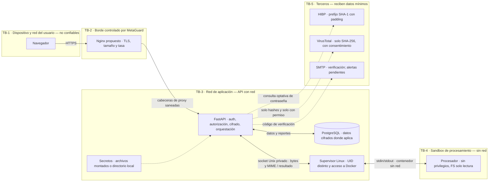

# Arquitectura y límites de confianza de MetaGuard

La API, PostgreSQL y el supervisor privado del procesador están implementados para una composición local. La figura incluye el borde Nginx y los servicios externos propuestos: no representa un despliegue instalado ni demuestra por sí sola los límites de confianza de OBJ-01.

## Contenido

## Decisiones y límites

| Componente | Responsabilidad / límite |
|---|---|
| Navegador | Interfaz y carga. Archivo, URL, nombre y cabeceras del cliente son datos no confiables. |
| Nginx (propuesto) | TLS, límite de cuerpo y tasa. El despliegue deberá descartar cabeceras IP aportadas por el cliente y establecer la IP de origen según la topología confiable. La demo usa el [proxy HTTPS local de Vite](desarrollo-local.md). |
| API | Autenticación, CSRF, autorización por objeto, validación de solicitud, cifrado de temporales en memoria y coordinación. No interpreta el formato. Consulta reputación por SHA-256 solo si se habilita el proveedor y hay consentimiento. |
| Procesador | `ProcessingSupervisor` fija imagen, comando y opciones Docker; entrega solo bytes y MIME mediante stdin al worker privado. El worker reutiliza `process_file`; el contenedor corre sin red ni privilegios, con raíz de solo lectura y límites de recursos. Ve el archivo en claro mientras lo procesa. |
| PostgreSQL | Cuentas, sesiones, reportes minimizados, eventos de sistema y caché. No recibe los archivos ni los valores extraídos por el procesador. No se acredita el cifrado de todo PostgreSQL. |
| Servicios externos | Si se habilitan, HIBP recibe solo el prefijo SHA-1 con padding, VirusTotal recibe solo SHA-256 con consentimiento por archivo y SMTP entrega un código sin archivos adjuntos. La demo mantiene HIBP y VirusTotal desactivados y usa SMTP de loopback sin relay. |

La propuesta define al operador como confiable, no como incapaz de ver el archivo: se procesa en claro dentro del worker. El transporte Unix existe y el worker no recibe llaves ni acceso a red. La API usa [llaves separadas](llaves-y-secretos.md) desde archivos protegidos; la operación y rotación de producción siguen pendientes.

## Qué pasa si falta

Sin límites de confianza y separación comprobable, un archivo hostil podría alcanzar componentes con red o datos persistentes y la promesa de aislamiento no se podría evaluar. La figura no prueba que el despliegue real respete los límites.

## Evidencia local y límites

El código configura `--network=none`, `--read-only`, usuario no-root, capacidades vacías, `no-new-privileges`, 1 GiB/1 vCPU, 60 s, 64 MiB de `/tmp` y limpieza por nombre de contenedor. La [evidencia de staging](validacion-staging.md#estado-observado) registra la imagen local por digest y procesamiento sintético con Docker en Ubuntu/WSL2. El recorrido de la interfaz usó un adaptador WSL, no el socket Unix nativo con UID separados.

## IPC privado entre API y supervisor

**Estado:** cliente, protocolo y listener implementados con pruebas simuladas. La [configuración Linux](procesamiento-archivos.md#run-the-private-listener-on-linux) no da a la API autoridad sobre Docker ni entrega llaves al procesador. Falta probar el recorrido por el socket nativo con los UID y el entorno de staging reales antes de habilitar cargas reales.

### Flujo y autoridad

1. La API comprueba autenticación, origen/CSRF, titularidad y límites según la operación. Cifra los temporales en memoria; el consentimiento controla solo la consulta de reputación, no la carga ni la limpieza.
2. Un servicio supervisor confiable en el host recibe de la API **solo bytes y tipo de medio permitido** por un socket Unix de flujo dedicado. Lanza el procesador existente con imagen y argumentos fijados; responde con el resultado acotado. El contenedor aislado no recibe el socket de la API, el socket Docker, llaves ni acceso de red.
3. La API verifica el resultado del protocolo y lo entrega como descarga segura. El archivo procesado sigue siendo contenido no confiable; la marca interna de verificación no prueba seguridad frente a una ejecución de código dentro del procesador.

El supervisor tiene autoridad sobre Docker y debe tratarse como **componente privilegiado del host**, no como una extensión inocua de la API. Requiere una configuración confiable y explícita de ejecutable absoluto, socket Unix local, directorio de configuración e imagen por digest; sus procesos reciben únicamente `DOCKER_HOST` y `DOCKER_CONFIG`, sin heredar el entorno. La validación sintáctica no demuestra propiedad o permisos de esas rutas ni procedencia de la imagen. El despliegue debe verificarlos. No debe aceptar del cliente rutas, nombres de contenedor, imágenes, comandos, opciones, montajes ni variables de entorno.

### Controles y requisitos de despliegue

- El directorio padre y el socket son propiedad del supervisor y no son modificables por la API; permisos restrictivos y credenciales de pares Linux autentican **ambos extremos antes de transferir datos**. Deben comprobarse los UID reales y su correspondencia entre espacios de nombres. La identidad del proceso no sustituye autorización del usuario ni titularidad del archivo.
- El protocolo debe ser versionado y con longitudes explícitas, una tarea por conexión, esquemas cerrados, tipos permitidos y límites comprobados antes de reservar memoria. Rechazar mensajes truncados, campos repetidos, tramas adicionales y datos auxiliares no admitidos. No usar pickle ni rutas aportadas por el cliente.
- Limitar globalmente tareas activas, cola y bytes acumulados, además de tiempo de lectura, escritura, ejecución y limpieza. La desconexión no debe dejar trabajos sin seguimiento. Mantener el cupo retenido hasta confirmar limpieza.
- Ante limpieza no verificable, el servicio debe rechazar nuevas tareas hasta reconciliarse. Tras reinicio o caída del daemon, inventariar tareas propias mediante identificadores y etiquetas controlados; nunca borrar contenedores por coincidencia amplia de nombre.
- Evitar registrar contenido, nombres sensibles o resultados crudos. La memoria temporal no garantiza ausencia de persistencia: deben evaluarse buffering multipart y del proxy, archivos temporales, swap, hibernación y volcados. No prometer borrado criptográfico ni eliminación segura de objetos inmutables de Python.

### Evidencia necesaria antes de usarlo

Las pruebas deberán cubrir pares no autorizados, socket falsificado y mapeo de UID; tramas fragmentadas o excesivas, clientes lentos y desconexiones; cuotas concurrentes y saturación; aislamiento real de red, montajes y recursos; caída del supervisor o daemon y recuperación de huérfanos; y ausencia de datos señuelo en logs y almacenamiento temporal. También deberán comprobar autorización entre usuarios, consentimiento, cifrado, descarga y vencimiento. Las pruebas simuladas no sustituyen la inspección del aislamiento real.

Referencias: [seguridad del daemon Docker](https://docs.docker.com/engine/security/), [sockets Unix y credenciales de pares en Linux](https://man7.org/linux/man-pages/man7/unix.7.html) y [consideraciones de tmpfs y swap](https://docs.docker.com/engine/storage/tmpfs/).
